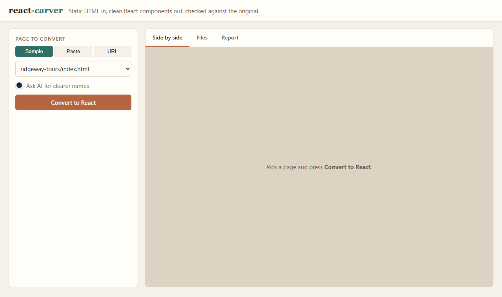
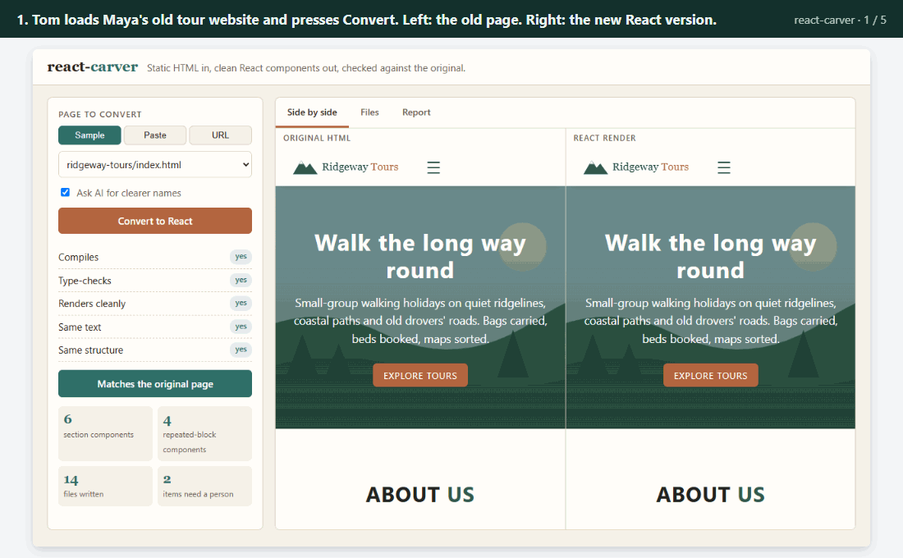
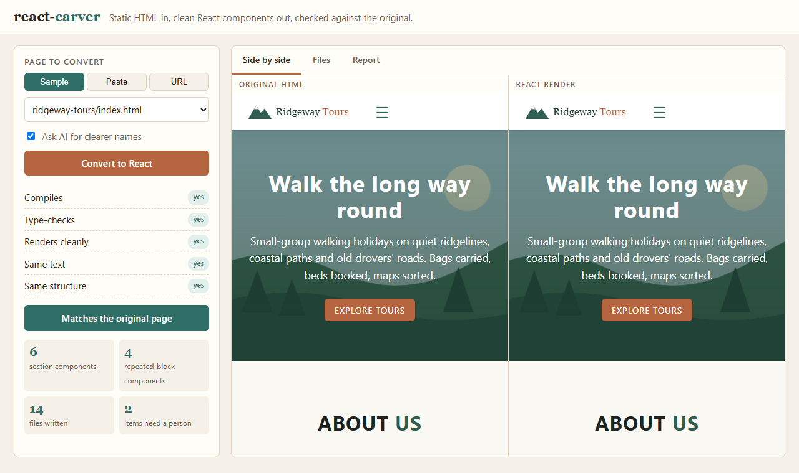
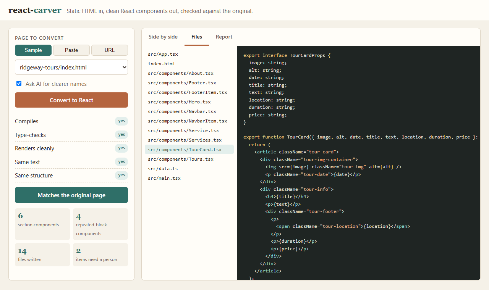
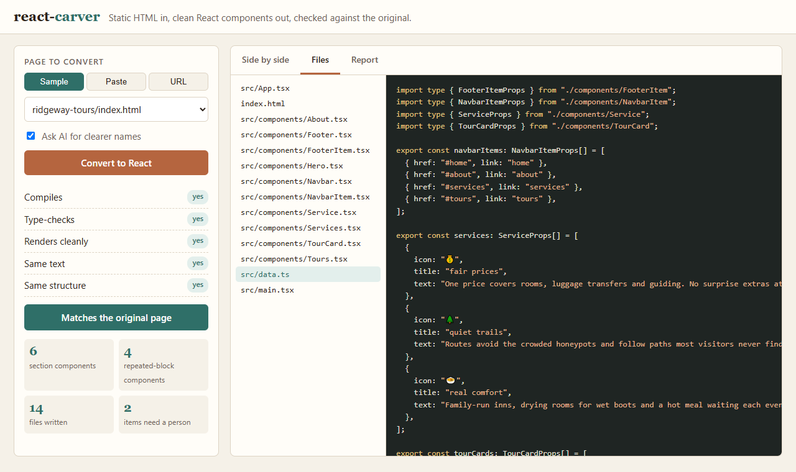
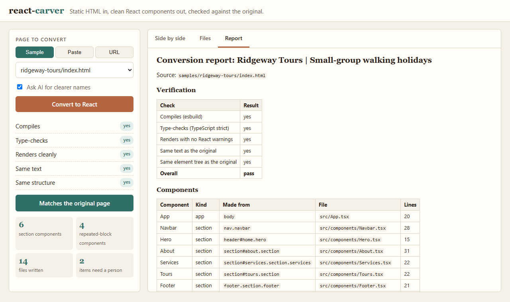
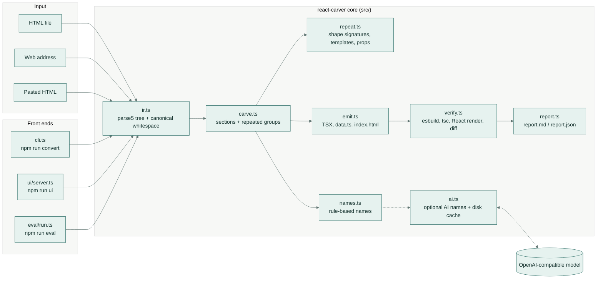
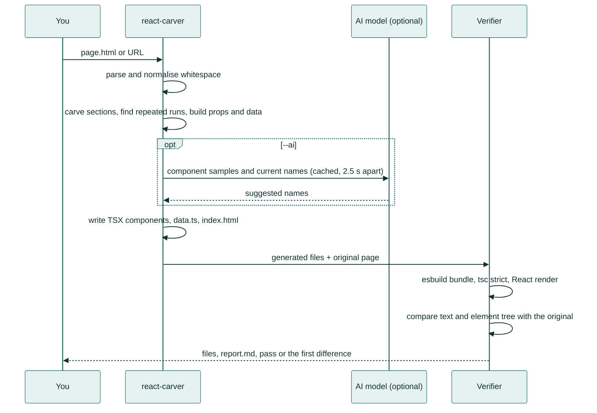
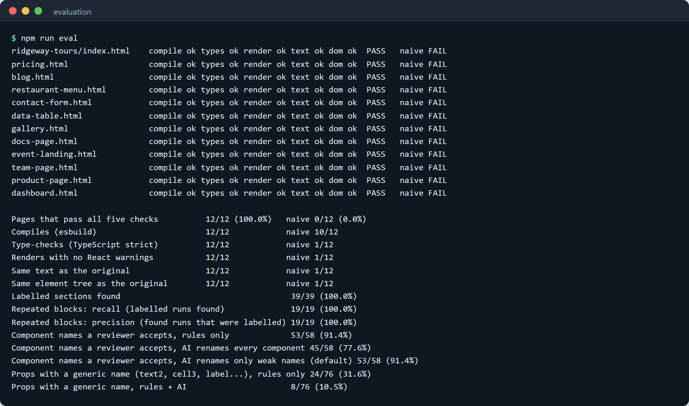
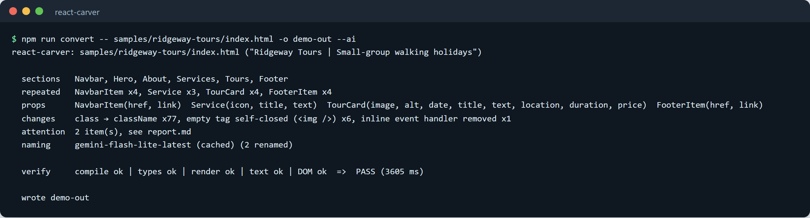

# react-carver

Turn an old static web page into a clean, ready-to-edit React project. react-carver then proves the new version
shows exactly the same page.



*The demo: a tour company's old web page goes in and its React version comes out. Both are shown side by side,
followed by the building blocks it was split into, and finally a report of what still needs a person.*

## What it does

You give it a web page, as a file or a link. It rebuilds the page as a modern React project, split into small,
named building blocks. Repeated pieces, such as product cards or price plans, become one block plus a simple list of
their details. Before handing it over, it checks that the new version shows the same words in the same layout as
the original.

## A real-life example

**Maya** runs **Ridgeway Tours**, a small walking-holiday company. Her website is one hand-written HTML page from
years ago. Her freelance developer, **Tom**, needs to move it to React so he can add online booking.

- **Before:** Tom would copy the page into React by hand. That means fixing hundreds of small differences, cutting
  it into pieces, retyping each tour card, and then clicking through the result to make sure nothing broke. For a
  page like Maya's, that is a day or two of careful, dull work.
- **With react-carver:** Tom runs one command. In a few seconds he has a React project with a `Hero`, `About`,
  `Services` and `Tours` section and one `TourCard` block fed by a list of four tours. It comes with a green
  "matches the original page" check and a note that the old menu-button script needs rebuilding.
- **After:** Tom starts the booking work the same morning. When Maya adds a fifth tour, it is one new entry in a
  list rather than a copied block of HTML.



*The same story in five slides: the page goes in, the result is checked, the cards become one block, the tour
details become a list, and a report says what is left to do.*

## How you would use it

1. Open the tool in your browser (`npm run ui`, then go to `http://localhost:5178`).
2. Choose a sample page, paste your page's HTML, or type its web address.
3. Optionally tick **Ask AI for clearer names**.
4. Press **Convert to React**.
5. Compare the two previews, read the files, and check the report. From the command line, the same result is
   written to a folder you choose, ready to copy into your project.

| | |
| --- | --- |
|  |  |
| *Left: the old page. Right: the React version. The green checks on the left confirm they match.* | *One of the building blocks it made: a tour card that takes a picture, a date, a title and a price.* |
|  |  |
| *The details of every card, gathered into one list that is easy to edit.* | *The report: what was checked, what was made, and what still needs a person.* |

---

## Technical overview

react-carver is a command-line tool and a small local web app, written in TypeScript for Node.js. It reads HTML
with [parse5](https://github.com/inikulin/parse5) (the same HTML parsing rules browsers follow) and writes a
React + TypeScript project: `index.html`, `src/main.tsx`, `src/App.tsx`, one file per component and `src/data.ts`.

Key features:

- **Splits the page by structure.** Landmarks (`header`, `nav`, `main`, `section`, `footer`, `aside`, `form`,
  `article`) become section components, nested up to three levels. Plain wrapper `div`s are passed through.
- **Finds repeated blocks.** Runs of sibling elements with the same shape (cards, table rows, list items) become one
  component with typed props and a data array, rendered with `.map()`. Values that differ become props. Lists of
  different lengths inside each block (such as plan features) become array props, and runs of identical icons
  (such as review stars) become a number. The same block used in two places shares one component.
- **Converts every attribute the way React expects.** `class` and `for` become `className` and `htmlFor`. Inline
  `style` strings become style objects, including vendor prefixes and CSS custom properties. Boolean and numeric
  attributes get real `true` and number values, and SVG attributes are camelCased. Form starting values move to
  `defaultValue` / `defaultChecked`, and empty tags are self-closed.
- **Keeps the text exactly.** It follows HTML's whitespace rules, so spaces between inline elements, non-breaking
  spaces, `<pre>` blocks and characters like `{` `}` `<` `&` come out unchanged.
- **Reports what needs a person.** Inline event handlers (`onclick="..."`), `<script>` tags, `<noscript>`,
  framework attributes such as `@click`, `javascript:` links and `!important` styles are removed and listed.
- **Proves the result.** Every conversion is compiled with esbuild and type-checked with the TypeScript compiler in
  strict mode. It is then rendered with React's server renderer (React's way of producing HTML without a browser)
  and compared with the original page for the same text and the same element tree.
- **Optional AI naming.** A language model suggests clearer component and prop names. It goes through any
  OpenAI-compatible endpoint (Gemini by default), answers are cached on disk, and calls are at least 2.5 s apart.
  Without a key it falls back to the rule-based names.

## Architecture



## How it works



Step by step:

1. **Parse.** parse5 reads the page exactly as a browser would, including implied tags like `<tbody>`. The head is
   kept for `index.html` (title, meta, stylesheets, external scripts). The body becomes a small tree.
2. **Normalise.** Comments, scripts and inline handlers are set aside for the report. Whitespace is reduced to what
   a browser actually shows: one space between inline elements, nothing at block edges, exact text in `<pre>`. The
   verifier applies the same rules to the rendered output, so the comparison is fair.
3. **Carve sections.** Landmark elements become components, named from their landmark role, id, class or first
   heading.
4. **Find repeated blocks.** Each element gets a shape signature: its tag, its attribute names and its children's
   signatures, with runs of identical children collapsed. Neighbours with the same signature form a run (two for
   cards, three for list rows and table rows). Runs with the same shape and classes anywhere on the page share one
   component.
5. **Build the template.** The blocks in a run are lined up node by node. A value that is the same everywhere stays
   in the component. A value that differs becomes a prop, named from its class (`tour-date` gives `date`), its tag
   (`h3` gives `title`) or its attribute (`src` gives `image`). The data goes to `src/data.ts`, typed with the
   component's props interface.
6. **Name (optional AI).** The model sees each component's current name, an HTML sample and its props with sample
   values, and suggests better names. Prop names are open to it. A component name is changed only when the rule-based
   name was a guess (built from a heading or the parent's name), because names taken from ids and classes scored
   better in the evaluation. Suggestions are validated (PascalCase or camelCase, no reserved words, no clashes).
7. **Emit.** The tree is printed as JSX with 2-space indentation, wrapped attributes and wrapped text. It also writes
   `index.html` and `main.tsx`, and copies local images and stylesheets into `public/`.
8. **Verify.** The files are bundled in memory with esbuild and type-checked with the TypeScript compiler API
   (strict, unused-variable checks on). `<App />` is then rendered with `react-dom/server`, collecting any React
   warnings. The result is compared with the original body. The report gives the first difference if there is one.

## Evaluation

`npm run eval` converts 12 sample pages in [`samples/`](samples/), including:
- a landing page, pricing plans, a blog index, a restaurant menu, a booking form and a data table;
- a photo gallery with inline SVG, a documentation page with code blocks and entities, an event page with inline
  handlers and scripts;
- a team page, a product page and an admin dashboard.

The expected sections, repeated runs and acceptable names for each page are written down by hand in
[`eval/labels.json`](eval/labels.json), from the pages alone. The baseline is the usual find-and-replace
conversion ([`eval/naive.ts`](eval/naive.ts)): paste the body into one component and fix `class`, `for`, empty tags
and comments with regular expressions.

**Output correctness** (a page passes when all five checks pass):

| Check | react-carver | Naive find-and-replace |
| --- | --- | --- |
| Pages that pass all five checks | **12/12 (100%)** | 0/12 (0%) |
| Compiles (esbuild) | 12/12 | 10/12 |
| Type-checks (TypeScript strict) | 12/12 | 1/12 |
| Renders with no React warnings | 12/12 | 1/12 |
| Same text as the original | 12/12 | 1/12 |
| Same element tree as the original | 12/12 | 1/12 |

**Structure and naming:**

| Measure | Result |
| --- | --- |
| Labelled sections found | 39/39 (100%) |
| Repeated blocks, recall (labelled runs found) | 19/19 (100%) |
| Repeated blocks, precision (found runs that were labelled) | 19/19 (100%) |
| Component names a reviewer accepts: rules only | 53/58 (91.4%) |
| Component names a reviewer accepts: AI renames every component | 45/58 (77.6%) |
| Component names a reviewer accepts: AI renames only guessed names (default) | 53/58 (91.4%) |
| Props with a generic name (`text2`, `cell3`, `label`...): rules only | 24/76 (31.6%) |
| Props with a generic name: rules + AI | **8/76 (10.5%)** |

So the AI step earns its place on prop names, cutting generic ones by two thirds. It is kept away from component
names the rules already got from ids and classes. The model is `gemini-flash-lite-latest`. Its answers are
committed in [`eval/ai-cache/`](eval/ai-cache/), so `npm run eval` reproduces these numbers without a key or any
model call. Full per-page results are in [`eval/results.md`](eval/results.md).



*The evaluation run: every sample page passes all five checks, while the find-and-replace baseline passes none.*

## Tech stack

- **Node.js 22** (runs TypeScript directly with `--experimental-strip-types`) and **TypeScript 5.9**, strict.
- **parse5** for HTML parsing.
- **esbuild** for compiling the generated code, **TypeScript compiler API** for type-checking it,
  **React 19 / react-dom/server** for rendering it.
- **OpenAI-compatible chat API** over plain `fetch` for the optional AI step (Gemini by default).
- **Vitest** for tests, **ESLint** with typescript-eslint for linting, **GitHub Actions** for CI.
- The web UI is one HTML file served by Node's `http` module: no framework and no build step.

## Setup

Requires Node.js 22.6 or newer.

```bash
npm install          # one-time setup
npm run demo         # convert the sample tour page into ./demo-out and verify it
```

## Usage

```bash
# Convert a file or a URL; files go to ./react-out unless -o is given
npm run convert -- path/to/page.html -o my-react-app
npm run convert -- https://example.com/page.html -o my-react-app

# Options
#   --ai             ask the AI model for clearer names (needs AI_API_KEY)
#   --no-typecheck   verify without the TypeScript check (faster)
#   --no-verify      skip verification entirely

# Local web UI on http://localhost:5178
npm run ui

# Evaluation over the labelled samples (writes eval/results.md and eval/results.json)
npm run eval
```



*A command-line run: the sections and repeated blocks it found, the props it made, and the five checks.*

The output folder is laid out like a Vite React + TypeScript project: `index.html` loads `/src/main.tsx`, and
local images and stylesheets sit in `public/`. The CLI exits with code 1 when verification fails,
which makes it usable in scripts.

## Configuration

All settings are environment variables. None are needed for the rule-based mode.

| Variable | Purpose | Default |
| --- | --- | --- |
| `AI_API_KEY` | Key for the AI naming step. Without it, names come from the rules (or the cache). | unset |
| `AI_BASE_URL` | OpenAI-compatible endpoint | Gemini's OpenAI-compatible URL |
| `AI_MODEL` | Model name | `gemini-flash-lite-latest` |
| `AI_CACHE_DIR` | Where answers are cached | `.cache/ai` |
| `PORT` | Port for the web UI | `5178` |

Pass the key only at run time, for example `AI_API_KEY="$GEMINI_API_KEY" npm run convert -- page.html --ai`.

## Project structure

```text
react-carver/
├── src/
│   ├── ir.ts           parse5 → small tree; canonical whitespace rules shared with the verifier
│   ├── attrs.ts        attribute and style conversion, issue detection
│   ├── carve.ts        section components, repeated groups, data arrays
│   ├── repeat.ts       shape signatures, run detection, templates and props
│   ├── names.ts        rule-based component and prop names
│   ├── ai.ts           optional AI naming (OpenAI-compatible, cached, rate-spaced)
│   ├── emit.ts         JSX/TSX printer and project files
│   ├── verify.ts       esbuild + tsc + React render + tree comparison
│   ├── convert.ts      the pipeline and the report data
│   ├── report.ts       report.md and terminal summary
│   ├── cli.ts          command line
│   └── ui/             local web UI (server.ts + index.html)
├── eval/               labels, baseline, evaluation runner, cached AI answers, results
├── samples/            12 sample pages (fictional businesses)
├── tests/              Vitest tests
├── docs/               demo GIFs and screenshots
└── .github/workflows/  CI
```

## Tests

```bash
npm test             # 47 tests
npm run check        # lint + typecheck + tests + evaluation (fails below a 100% pass rate)
```

The tests cover:
- attribute, style and whitespace rules; shape signatures and run detection; templates, props and data;
- naming rules;
- end-to-end conversions verified by compile, type-check and render, including the verifier catching wrong text and
  type errors;
- the AI step with a mocked endpoint (validation, caching, 2.5 s spacing, fallback);
- the CLI.

CI runs lint, type-check, tests, the evaluation (requiring 12/12) and the demo, with `AI_API_KEY` empty so no model
is ever called.

## Licence

MIT. See [LICENSE](LICENSE).
